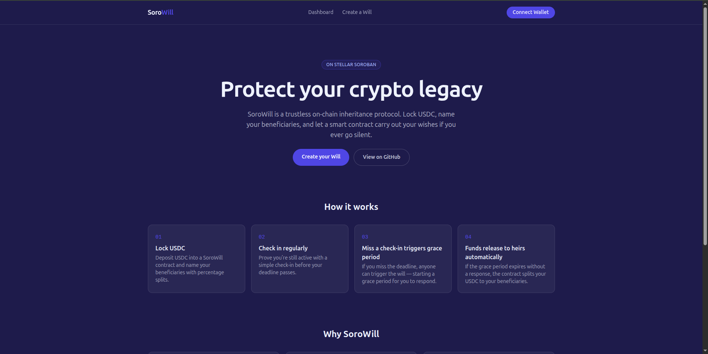

# SoroWill App

**On-chain inheritance, in your browser**

[](https://nextjs.org/)
[](https://www.typescriptlang.org/)
[](https://tailwindcss.com/)
[](https://developers.stellar.org/)
[](./LICENSE)

**Live app: [sorowill.vercel.app](https://sorowill.vercel.app/)**



## What is SoroWill

SoroWill is a trustless, on-chain inheritance protocol on Stellar Soroban. This app is the dashboard for it: create a will, check in to prove you're active, review beneficiaries and guardians, and — for anyone named as a beneficiary — verify and claim an inheritance once a will's grace period has elapsed.

## Tech Stack

- **Next.js 16** (App Router; `next` ^16.3.0)
- **TypeScript** (strict mode)
- **Tailwind CSS 3**
- **[@sorowill/sdk](../sorowill-sdk)** for all contract interaction and Freighter wallet handling

> **Wallet support:** This app currently only supports the **[Freighter](https://freighter.app/)** browser extension. Other Stellar wallets (Albedo, xBull, Rabet, …) are not yet supported — you will not be able to connect them. Multi-wallet support is tracked in the SDK's wallet-adapter work; see the [`@sorowill/sdk`](https://www.npmjs.com/package/@sorowill/sdk) package for progress.

## Local Setup

```bash
git clone https://github.com/SoroWill/sorowill-app.git
cd sorowill-app
# The .nvmrc file pins Node 20 (matching CI). If you use nvm/fnm/volta, run:
#   nvm use       (nvm)
#   fnm use        (fnm)
#   volta install  (volta)
npm install
cp .env.example .env.local
# fill in NEXT_PUBLIC_CONTRACT_ID_TESTNET (and NEXT_PUBLIC_CONTRACT_ID_MAINNET
# if you're targeting mainnet) with your deployed SoroWill contract address
npm run dev
```

> This app depends on [`@sorowill/sdk`](https://www.npmjs.com/package/@sorowill/sdk), published to npm under the `sorowill` org.

## Environment Variables

| Variable | Description |
|---|---|
| `NEXT_PUBLIC_STELLAR_NETWORK` | Stellar network to connect to: `testnet` or `mainnet` |
| `NEXT_PUBLIC_CONTRACT_ID_MAINNET` | Address of the deployed SoroWill contract on mainnet. **Required** when the network is mainnet; there is no fallback. |
| `NEXT_PUBLIC_CONTRACT_ID_TESTNET` | Address of the deployed SoroWill contract on testnet (preferred). |
| `NEXT_PUBLIC_CONTRACT_ID` | Legacy single-var fallback. Used only on testnet when `NEXT_PUBLIC_CONTRACT_ID_TESTNET` is unset. Never used on mainnet. |
| `NEXT_PUBLIC_RPC_URL` | Soroban RPC endpoint (defaults to the public testnet RPC) |
| `RESEND_API_KEY` | API key for reminder emails (optional; leave unset to skip sending) |
| `RESEND_FROM_EMAIL` | Verified Resend sender address used for reminder emails |
| `KV_REST_API_URL` | Vercel KV / Upstash Redis REST URL used to persist reminder subscriptions (required for reminders; the serverless filesystem is ephemeral) |
| `KV_REST_API_TOKEN` | REST token for the KV store above |
| `REMINDER_STORE_KV_KEY` | Optional key used to store the reminder blob in the KV store (defaults to `sorowill:reminder-store`) |
| `CRON_SECRET` | Bearer token for authenticating automated reminder dispatch requests from GitHub Actions (required if using the automated GitHub Actions trigger; see [Reminder delivery](#reminder-delivery)). **Must be at least 32 random characters** (e.g. `openssl rand -hex 32`); shorter secrets are rejected with a warning because they weaken the timing-safe comparison. |
| `NEXT_PUBLIC_APP_URL` | Optional public base URL used to build the unsubscribe link in reminder emails (defaults to `VERCEL_URL` or `http://localhost:3000`) |
| `RATE_LIMIT_DEFAULT_MAX` | Default max requests allowed per window for API routes (defaults to `60`) |
| `RATE_LIMIT_DEFAULT_WINDOW_MS` | Default rate-limit window in milliseconds (defaults to `60000`, i.e. 1 minute) |
| `RATE_LIMIT_<ENDPOINT>_MAX` | Per-endpoint override for max requests per window. `<ENDPOINT>` is the route name uppercased with non-alphanumerics replaced by `_` (e.g. `RATE_LIMIT_REMINDERS_CONFIRM_MAX` for `/api/reminders/confirm`) |
| `RATE_LIMIT_<ENDPOINT>_WINDOW_MS` | Per-endpoint override for the window in milliseconds (e.g. `RATE_LIMIT_REMINDERS_CONFIRM_WINDOW_MS`) |

## API Rate Limits

API routes are rate limited by `src/lib/rate-limit.ts`. Limits are configurable via environment variables so they can be tuned per deployment without a code change.

**Defaults** (used when no env vars are set):

- Max requests per window: **60**
- Window length: **60,000 ms** (1 minute)

**Per-endpoint configuration:** each endpoint can override the defaults by setting `RATE_LIMIT_<ENDPOINT>_MAX` and/or `RATE_LIMIT_<ENDPOINT>_WINDOW_MS`, where `<ENDPOINT>` is the route path uppercased with `/` and other non-alphanumeric characters replaced by `_`. For example, to allow 10 reminder confirmations per 5 minutes:

```bash
RATE_LIMIT_REMINDERS_CONFIRM_MAX=10
RATE_LIMIT_REMINDERS_CONFIRM_WINDOW_MS=300000
```

Unset or invalid values fall back to the defaults above, so existing behavior is preserved.

## Beneficiary Percentages

Beneficiary percentages must add up to exactly 100%. Each percentage may have up to
two decimal places and is stored as basis points (percentage x 100, so 33.33% is
3333), and all shares must sum to exactly 10,000 basis points. Splitting among three
beneficiaries as 33 + 33 + 33 totals only 99%, leaving 1% of the balance
undistributed (dust). A valid split is 33.33 + 33.33 + 33.34, which totals exactly
100%. Use "Distribute equally" to have the form assign the remainder for you.

## Design Tokens

The app uses custom theme tokens defined in `tailwind.config.ts`:

| Token | Value / Hex | Usage |
|---|---|---|
| `will-purple` | `#4F46E5` | Primary action color for buttons, interactive accents, active states, progress indicators |
| `will-dark` | `#1E1B4B` | Main page and container background brand base |
| `will-light` | `#EEF2FF` | Primary text and heading color across all views |

Opacity utilities such as `text-will-light/60` provide subdued secondary text, and `border-white/10` / `border-white/20` form consistent card borders and dividers.

## Pages

| Route | Description |
|---|---|
| `/` | Landing page explaining SoroWill |
| `/dashboard` | Your wills (owned and inherited), with quick check-in |
| `/will/new` | Multi-step form to create a new will |
| `/will/[id]` | Full will detail: check in, top up, update beneficiaries, cancel, trigger, release |
| `/inherit/[id]` | Beneficiary view — see your entitled share and claim once ready |
| `/verify/[id]` | Public, wallet-free verification of a will's on-chain state |

## Internationalization

This app uses **[next-intl](https://next-intl-docs.vercel.app/)** for translation strings and automatic locale detection.

### Supported Locales

- **`en`** — English (default)
- **`es`** — Español (Spanish)

### Locale Detection & Selection

The app automatically detects the user's preferred locale based on their browser's `Accept-Language` header:
- If the header requests Spanish (or any variant like `es-MX`, `es-AR`), the app displays Spanish content
- If the header requests English or any unsupported locale, the app defaults to English
- Users can manually switch locales using the **Language Selector** button in the header (top right, displays "EN" / "ES")
- The user's language preference is stored in `localStorage` for persistence across sessions

### Translation Files & Structure

Translation namespaces and strings are stored in `src/messages/`, organized by feature:

- **`src/messages/en.json`** — English translations
- **`src/messages/es.json`** — Spanish translations

Both files use the same structure with these namespaces:
- **`common`** — reusable UI strings (buttons, labels, form text)
- **`landing`** — landing page (`/`)
- **`dashboard`** — dashboard page (`/dashboard`)
- **`willDetail`** — will detail view (`/will/[id]`)
- **`status`** — will status labels and descriptions
- **`inherit`** — beneficiary inheritance view (`/inherit/[id]`)

### Using Translations in Components

To use translations in a component:

- **Server components:**
  ```typescript
  import { getTranslations } from 'next-intl/server';
  const t = await getTranslations('namespace');
  // Use t('key') in JSX
  ```

- **Client components:**
  ```typescript
  import { useTranslations } from 'next-intl';
  const t = useTranslations('namespace');
  // Use t('key') in JSX
  ```

### Adding a New Locale

To add support for a new language:

1. Create a new file `src/messages/[locale].json` (e.g., `src/messages/fr.json` for French)
2. Copy the structure from `src/messages/en.json` and translate all strings
3. Add the locale code to the `supportedLocales` array in `src/i18n/request.ts`
4. Add the locale to the `locales` array in `middleware.ts`
5. Test locale detection by setting your browser's language preference

### Middleware & Request Configuration

- **`middleware.ts`** — Handles locale detection from Accept-Language header; does not require URL pre
