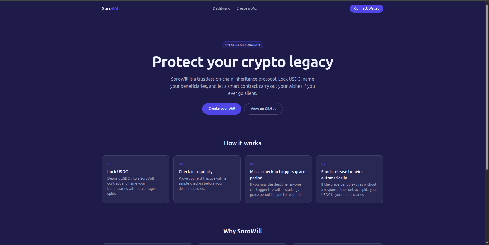

# SoroWill App

**On-chain inheritance, in your browser**

[](https://nextjs.org/)
[](https://www.typescriptlang.org/)
[](https://tailwindcss.com/)
[](https://developers.stellar.org/)
[](./LICENSE)

**Live app: [sorowill.vercel.app](https://sorowill.vercel.app/)**



## What is SoroWill

SoroWill is a trustless, on-chain inheritance protocol on Stellar Soroban. This app is the dashboard for it: create a will, check in to prove you're active, review beneficiaries and guardians, and — for anyone named as a beneficiary — verify and claim an inheritance once a will's grace period has elapsed.

## Tech Stack

- **Next.js 16** (App Router; `next` ^16.3.0)
- **TypeScript** (strict mode)
- **Tailwind CSS 3**
- **[@sorowill/sdk](../sorowill-sdk)** for all contract interaction and Freighter wallet handling

> **Wallet support:** This app currently only supports the **[Freighter](https://freighter.app/)** browser extension. Other Stellar wallets (Albedo, xBull, Rabet, …) are not yet supported — you will not be able to connect them. Multi-wallet support is tracked in the SDK's wallet-adapter work; see the [`@sorowill/sdk`](https://www.npmjs.com/package/@sorowill/sdk) package for progress.

## Local Setup

```bash
git clone https://github.com/SoroWill/sorowill-app.git
cd sorowill-app
# The .nvmrc file pins Node 20 (matching CI). If you use nvm/fnm/volta, run:
#   nvm use       (nvm)
#   fnm use        (fnm)
#   volta install  (volta)
npm install
cp .env.example .env.local
# fill in NEXT_PUBLIC_CONTRACT_ID_TESTNET (and NEXT_PUBLIC_CONTRACT_ID_MAINNET
# if you're targeting mainnet) with your deployed SoroWill contract address
npm run dev
```

> This app depends on [`@sorowill/sdk`](https://www.npmjs.com/package/@sorowill/sdk), published to npm under the `sorowill` org.

## Environment Variables

| Variable | Description |
|---|---|
| `NEXT_PUBLIC_STELLAR_NETWORK` | Stellar network to connect to: `testnet` or `mainnet` |
| `NEXT_PUBLIC_CONTRACT_ID_MAINNET` | Address of the deployed SoroWill contract on mainnet. **Required** when the network is mainnet; there is no fallback. |
| `NEXT_PUBLIC_CONTRACT_ID_TESTNET` | Address of the deployed SoroWill contract on testnet (preferred). |
| `NEXT_PUBLIC_CONTRACT_ID` | Legacy single-var fallback. Used only on testnet when `NEXT_PUBLIC_CONTRACT_ID_TESTNET` is unset. Never used on mainnet. |
| `NEXT_PUBLIC_RPC_URL` | Soroban RPC endpoint (defaults to the public testnet RPC) |
| `RESEND_API_KEY` | API key for reminder emails (optional; leave unset to skip sending) |
| `RESEND_FROM_EMAIL` | Verified Resend sender address used for reminder emails |
| `KV_REST_API_URL` | Vercel KV / Upstash Redis REST URL used to persist reminder subscriptions (required for reminders; the serverless filesystem is ephemeral) |
| `KV_REST_API_TOKEN` | REST token for the KV store above |
| `REMINDER_STORE_KV_KEY` | Optional key used to store the reminder blob in the KV store (defaults to `sorowill:reminder-store`) |
| `CRON_SECRET` | Bearer token for authenticating automated reminder dispatch requests from GitHub Actions (required if using the automated GitHub Actions trigger; see [Reminder delivery](#reminder-delivery)). **Must be at least 32 random characters** (e.g. `openssl rand -hex 32`); shorter secrets are rejected with a warning because they weaken the timing-safe comparison. |
| `NEXT_PUBLIC_APP_URL` | Optional public base URL used to build the unsubscribe link in reminder emails (defaults to `VERCEL_URL` or `http://localhost:3000`) |

## Beneficiary Percentages

Beneficiary percentages must add up to exactly 100%. Each percentage may have up to
two decimal places and is stored as basis points (percentage x 100, so 33.33% is
3333), and all shares must sum to exactly 10,000 basis points. Splitting among three
beneficiaries as 33 + 33 + 33 totals only 99%, leaving 1% of the balance
undistributed (dust). A valid split is 33.33 + 33.33 + 33.34, which totals exactly
100%. Use "Distribute equally" to have the form assign the remainder for you.

## Design Tokens

The app uses custom theme tokens defined in `tailwind.config.ts`:

| Token | Value / Hex | Usage |
|---|---|---|
| `will-purple` | `#4F46E5` | Primary action color for buttons, interactive accents, active states, progress indicators |
| `will-dark` | `#1E1B4B` | Main page and container background brand base |
| `will-light` | `#EEF2FF` | Primary text and heading color across all views |

Opacity utilities such as `text-will-light/60` provide subdued secondary text, and `border-white/10` / `border-white/20` form consistent card borders and dividers.

## Pages

| Route | Description |
|---|---|
| `/` | Landing page explaining SoroWill |
| `/dashboard` | Your wills (owned and inherited), with quick check-in |
| `/will/new` | Multi-step form to create a new will |
| `/will/[id]` | Full will detail: check in, top up, update beneficiaries, cancel, trigger, release |
| `/inherit/[id]` | Beneficiary view — see your entitled share and claim once ready |
| `/verify/[id]` | Public, wallet-free verification of a will's on-chain state |

## Internationalization

This app uses **[next-intl](https://next-intl-docs.vercel.app/)** for translation strings and automatic locale detection.

### Supported Locales

- **`en`** — English (default)
- **`es`** — Español (Spanish)

### Locale Detection & Selection

The app automatically detects the user's preferred locale based on their browser's `Accept-Language` header:
- If the header requests Spanish (or any variant like `es-MX`, `es-AR`), the app displays Spanish content
- If the header requests English or any unsupported locale, the app defaults to English
- Users can manually switch locales using the **Language Selector** button in the header (top right, displays "EN" / "ES")
- The user's language preference is stored in `localStorage` for persistence across sessions

### Translation Files & Structure

Translation namespaces and strings are stored in `src/messages/`, organized by feature:

- **`src/messages/en.json`** — English translations
- **`src/messages/es.json`** — Spanish translations

Both files use the same structure with these namespaces:
- **`common`** — reusable UI strings (buttons, labels, form text)
- **`landing`** — landing page (`/`)
- **`dashboard`** — dashboard page (`/dashboard`)
- **`willDetail`** — will detail view (`/will/[id]`)
- **`status`** — will status labels and descriptions
- **`inherit`** — beneficiary inheritance view (`/inherit/[id]`)

### Using Translations in Components

To use translations in a component:

- **Server components:**
  ```typescript
  import { getTranslations } from 'next-intl/server';
  const t = await getTranslations('namespace');
  // Use t('key') in JSX
  ```

- **Client components:**
  ```typescript
  import { useTranslations } from 'next-intl';
  const t = useTranslations('namespace');
  // Use t('key') in JSX
  ```

### Adding a New Locale

To add support for a new language:

1. Create a new file `src/messages/[locale].json` (e.g., `src/messages/fr.json` for French)
2. Copy the structure from `src/messages/en.json` and translate all strings
3. Add the locale code to the `supportedLocales` array in `src/i18n/request.ts`
4. Add the locale to the `locales` array in `middleware.ts`
5. Test locale detection by setting your browser's language preference

### Middleware & Request Configuration

- **`middleware.ts`** — Handles locale detection from Accept-Language header; does not require URL prefix (e.g., `/en/dashboard` — just `/dashboard`)
- **`src/i18n/request.ts`** — Loads the appropriate message file based on detected locale and provides a fallback to English

## Reminder delivery

Reminders are delivered by a server-side route that can be triggered on a schedule. The app ships a lightweight JSON store for subscriptions and dispatch history, so a daily cron job can call the dispatch endpoint without exposing any secrets.

The dispatch route (`/api/reminders/dispatch`) computes reminder windows from each will's `lastCheckin` and `checkinPeriodDays`, sending a well-before reminder once and an imminent reminder once for each active will that still has time left. The route is protected by a `CRON_SECRET` bearer token when configured.

### Automated Reminder Triggers

The application supports the following automated trigger mechanisms to schedule daily reminder dispatch:

#### GitHub Actions Workflow (Recommended)

**File:** `.github/workflows/reminder-cron.yml`

The primary automated trigger runs via GitHub Actions, scheduled daily at `08:00 UTC` (cron: `0 8 * * *`). The workflow:
- Runs on a fixed schedule every day
- Supports manual re-runs via the GitHub UI (`workflow_dispatch`)
- Keeps per-run logs for debugging and monitoring
- Fails visibly if the dispatch endpoint returns a non-2xx response

**Required GitHub Actions Secrets:**

To enable reminder delivery via GitHub Actions, set the following **repository secrets** (not to be confused with environment variables):

1. **`REMINDER_DISPATCH_URL`** — The full URL to your `/api/reminders/dispatch` endpoint
   - Example: `https://sorowill.vercel.app/api/reminders/dispatch`
   - For local/private deployments, use your deployment's public URL

2. **`CRON_SECRET`** — A secure bearer token that authenticates cron requests to the dispatch endpoint
   - This token is passed in the `Authorization: Bearer` header
   - **Must be at least 32 random characters** (e.g. generate with `openssl rand -hex 32`); treat it as a password
   - Shorter secrets are rejected with a warning, since low-entropy values weaken the timing-safe comparison
   - The API route validates this against the `CRON_SECRET` environment variable

**Configuration Steps:**

1. Go to your GitHub repository settings → Secrets and variables → Actions
2. Create a **New repository secret**:
   - Name: `REMINDER_DISPATCH_URL`
   - Value: Your app's dispatch endpoint URL (e.g., `https://your-deployment.vercel.app/api/reminders/dispatch`)
3. Create another **New repository secret**:
   - Name: `CRON_SECRET`
   - Value: A random string of **at least 32 characters** to serve as the bearer token (e.g., generate with `openssl rand -hex 32`). Shorter secrets are rejected with a warning because they weaken the timing-safe comparison.
4. Ensure your deployment has the corresponding `CRON_SECRET` environment variable set (see [Environment Variables](#environment-variables))

#### Manual Dispatch

For testing or one-off dispatch, you can manually call the endpoint with `curl`:

```bash
curl --fail -X POST https://your-app.example.com/api/reminders/dispatch \
  -H "Authorization: Bearer YOUR_CRON_SECRET" \
  -H "Content-Type: application/json"
```

### Scheduling Notes

- **Single Scheduler:** `.github/workflows/reminder-cron.yml` is the **only** scheduled trigger. A previous Vercel Cron entry that fired on the same schedule has been removed to avoid duplicate dispatch runs.
- **No Duplicate Triggers:** Do not add a second independent scheduler unless absolutely necessary; doing so causes the dispatch route to run multiple times in quick succession. If a backup scheduler is needed, give it a distinctly different schedule (e.g., a different hour) and document the intent here.
- **Race Condition Mitigation:** The dispatch route records `wellBeforeSentAt` and `imminentSentAt` timestamps per will in the KV store immediately after each send. Subscriptions with a recorded timestamp of that kind are skipped. This prevents duplicate reminders even if two dispatch runs overlap, though the lack of locking means a true race condition is still theoretically possible—yet another reason to keep a single scheduler.
- **Error Visibility:** GitHub Actions fails the run when the dispatch endpoint returns a non-2xx response, making broken dispatch immediately visible in the Actions UI.

## Keys and recovery

SoroWill is non-custodial and derives no keys; your wallet (e.g. Freighter) holds them. See [docs/KEY_DERIVATION.md](./docs/KEY_DERIVATION.md) for the wallet derivation path (SEP-0005, `m/44'/148'/x'`), how to verify it, and how to recover access.

## Key Management & Account Recovery

SoroWill does **not** generate, store, or derive any private keys or seed phrases. All signing and key custody is handled entirely by your connected wallet — currently **[Freighter](https://freighter.app/)**. SoroWill only reads the wallet's public address and submits transactions for the wallet to sign; private key material never passes through this app.

The "Certificate" / vault PDF export (available from a will's detail page) only contains the will's **public on-chain data** — id, owner, status, balance, and beneficiaries — plus a QR code for quick verification. It contains no key material and **cannot** be used to recover wallet access.

If you lose access to your wallet, SoroWill cannot help you recover it. Use your wallet provider's own recovery process (for Freighter, this means restoring from your backed-up seed phrase — see Freighter's documentation at [freighter.app](https://freighter.app/)).

## Contributing via Drips Wave

This repo participates in the **Stellar Wave Program** on [Drips](https://drips.network/wave). Maintainer-tagged issues carry Point values, and contributors who resolve them during an active Wave earn a proportional share of that Wave's reward pool. See [CONTRIBUTING.md](./CONTRIBUTING.md) for the contribution workflow, and <https://drips.network/wave> for how Wave itself works.
